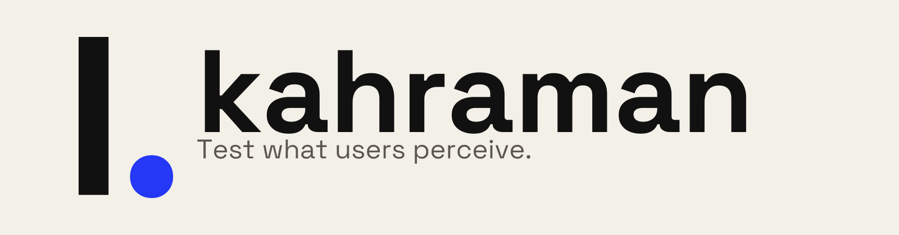

# kahraman



kahraman lets you write Storybook and Vitest browser tests as the steps a user
takes: `I.click(button('Continue'))`, then `I.see(heading('Welcome, Ada'))`. It
finds elements by role, accessible name, or text content, so tests target what
users perceive instead of markup details. When a step fails, the error shows
the steps that led to it and points at the line in your story.

- **Role and text locators only.** `role()` and `text()`, plus `heading()`,
  `button()`, and `link()` shorthands. There are no CSS selector or test ID
  locators.
- **CodeceptJS-style actor.** `I.see`, `I.fill`, `I.click`, `hopeThat`,
  `retryTo`, and `tryTo` run inside a story's `play` function or a Vitest
  browser test. There is no separate runner or browser driver.
- **Readable failures.** The error ends with a `✔`/`✖` trace of actor steps, and
  the stack starts at the story line that made the failing call.
- **Steps in the Interactions panel.** Storybook shows each call as a
  collapsible `I.click(button "Continue")` group, with no setup.
- **Any renderer.** kahraman reads only `canvasElement` and `userEvent` from the
  story context, so React, Vue, Svelte, and the other renderers work the same.
- **Storybook 9, 10, and 11.** CI typechecks and tests against all three. No
  runtime dependencies besides the `storybook` peer.

```ts
import { createActor, button, heading, role } from 'kahraman'

const I = createActor()

// in a CSF Next story file that defines `meta`
export const Default = meta.story()
Default.test('signs the user in', async (context) => {
	I.init(context)
	await I.see(heading('Sign in'))
	await I.fill(role('textbox', 'Email'), 'ada@example.com')
	await I.click(button('Continue'))
	await I.waitExit(role('status'))
	await I.see(heading('Welcome, Ada'))
})
// If the welcome heading never renders, the test fails with:
//
// Unable to find an accessible element with the role "heading" and name "Welcome, Ada"
// …
// Actor steps (most recent last):
//   ✔ I.see(heading "Sign in")
//   ✔ I.fill(textbox "Email", "ada@example.com")
//   ✔ I.click(button "Continue")
//   ✔ I.waitExit(status)
//   ✖ I.see(heading "Welcome, Ada")
```

https://github.com/user-attachments/assets/a7e5ee02-7ded-4aea-a8a7-1ff3ad713914

[Download the film](https://github.com/apphane-dev/kahraman/releases/download/media-2026-10-15/kahraman-silent.mp4).
Made with [fframes](./fframes/README.md). The `I.` logo, colors, and type are in
[brand/](./brand/README.md).

Built and maintained by [apphane](https://apphane.dev/).

---

## Contents

- [Getting started](#getting-started)
  - [Plain Vitest browser mode](#plain-vitest-browser-mode)
  - [Vendor the source with jsrepo](#vendor-the-source-with-jsrepo)
- [Why kahraman](#why-kahraman)
- [Locators](#locators)
- [Actor methods](#actor-methods)
- [Page actors](#page-actors)
- [Storybook Interactions panel](#storybook-interactions-panel)
- [Failure diagnostics](#failure-diagnostics)
- [Consumer configuration](#consumer-configuration)
- [AI agent skill](#ai-agent-skill)
- [Development](#development)

## Getting started

You need a Storybook 9, 10, or 11 project, with any renderer, on Node.js 22.12
or newer. For tests without stories, see
[Plain Vitest browser mode](#plain-vitest-browser-mode).

1. Install the package. `storybook` is a peer dependency, and a Storybook
   project already has it.

   ```sh
   npm install --save-dev kahraman
   # or: pnpm add -D kahraman
   ```

2. Add a story whose `play` function drives the component through an actor.
   Swap `SignIn` and the locators for one of your components, and the type
   import for your framework package.

   ```ts
   // SignIn.stories.ts
   import type { Meta, StoryObj } from '@storybook/react-vite'
   import { button, createActor, heading, role } from 'kahraman'

   import { SignIn } from './SignIn'

   const meta = { component: SignIn } satisfies Meta<typeof SignIn>
   export default meta

   const I = createActor()

   export const SignsIn: StoryObj<typeof meta> = {
   	play: async (context) => {
   		I.init(context)
   		await I.see(heading('Sign in'))
   		await I.fill(role('textbox', 'Email'), 'ada@example.com')
   		await I.click(button('Continue'))
   	},
   }
   ```

   `I.init(context)` must run before any other actor call. It connects the
   actor to the story's canvas and `userEvent` and clears the step trace. With
   CSF Next, call it the same way inside `.test(...)`, as in the example at the
   top.

3. Open the story in Storybook. The Interactions panel lists each `I.*` call as
   a step. If you run stories as tests with Storybook's Vitest addon, the same
   `play` function runs there.

4. Optional: register the [diagnostics addon](#shorter-element-not-found-errors)
   to cut Testing Library's element-not-found errors down to the role you
   queried.

kahraman ships ESM only.

### Plain Vitest browser mode

A [Vitest browser mode](https://vitest.dev/guide/browser/) test without stories
passes its own container and a `userEvent.setup()` instance from
`storybook/test`, the same kind a story context carries:

```ts
import { createActor, heading } from 'kahraman'
import { userEvent } from 'storybook/test'
import { test } from 'vitest'

test('shows the dashboard', async () => {
	const canvasElement = document.createElement('div')
	document.body.append(canvasElement)
	render(canvasElement) // mount your UI here

	const I = createActor()
	I.init({ canvasElement, userEvent: userEvent.setup() })
	await I.see(heading('Dashboard'))
})
```

Install `storybook` next to kahraman, because the actor's queries and
assertions come from `storybook/test`. You don't need a `.storybook` config or a
running Storybook:

```sh
npm install --save-dev kahraman storybook
```

The `userEvent.setup()` instance keeps keyboard and pointer state between actor
calls, so a key held with `I.press('{Shift>}')` is still held for the next
`I.click(...)`. Passing `userEvent` itself also works, but each of its calls
starts from fresh state.

### Vendor the source with jsrepo

kahraman is also a [jsrepo](https://jsrepo.dev) registry. To own the code,
copy the source into your project and adapt it:

```sh
# the actor + locator DSL
npx jsrepo add github/apphane-dev/kahraman/actor

# the opt-in diagnostics preview annotation
npx jsrepo add github/apphane-dev/kahraman/preview

# include the unit tests and the example page actor too
npx jsrepo add --with test --with example github/apphane-dev/kahraman/actor
```

The npm tarball also contains the full source in `src/`, for reference.

## Why kahraman

Here is the start of the Getting started test written against `storybook/test`
directly:

```ts
play: async ({ canvas, userEvent }) => {
	await expect(canvas.getByRole('heading', { name: 'Sign in' })).toBeInTheDocument()
	await userEvent.type(canvas.getByRole('textbox', { name: 'Email' }), 'ada@example.com')
	await userEvent.click(canvas.getByRole('button', { name: 'Continue' }))
}
```

The kahraman version differs in what happens around each line:

- `I.fill` replaces the field's value, waits until the input holds it, and tabs
  out. `userEvent.type` appends to whatever the field already contains.
- The Interactions panel shows `I.fill(textbox "Email", "ada@example.com")`
  instead of the raw query, event, and `expect` calls.
- A failure carries the step trace from the top of this README.

With plain `storybook/test` you can still reach for `getByTestId` or
`querySelector`. kahraman's locators stop at roles, accessible names, and
text content, so the easiest locator to write is also the accessible one.

---

## Locators

Build locators with `role` and `text`, or the `heading`, `button`, and `link`
shorthands, then refine them:

```ts
import { role, text, heading, button, link } from 'kahraman'

role('textbox', 'Email') // by role + accessible name
heading('Dashboard') // role('heading', 'Dashboard')
text(/items? found/) // by text content (string or RegExp)

link('Storage').options({ current: 'page' }) // extra Testing Library options
button('Save').within(role('dialog')) // scope to a container
role('listitem').all() // all matches (for counts)
role('status', 'Loading').wait() // findBy* (async)
role('alert').maybe() // queryBy* (nullable)
```

| Transition   | Query mode          | Returns              |
| ------------ | ------------------- | -------------------- |
| _(default)_  | `getBy*`            | one element (throws) |
| `.wait()`    | `findBy*`           | `Promise<element>`   |
| `.all()`     | `getAllBy*`         | `element[]`          |
| `.maybe()`   | `queryBy*`          | `element \| null`    |
| `.within(s)` | scope to `s`        | same variant, scoped |
| `.options()` | merge query options | same variant         |

`.within(scope)` accepts a locator, an `HTMLElement`, or `'global'` for the
whole document body.

## Actor methods

```ts
// Assertions
await I.see(role('alert')) // present in the document
await I.dontSee(button('Delete')) // absent
await I.waitExit(role('status')) // wait for it to disappear (stabilization)
await I.seeInField(role('textbox', 'Email'), 'ada@example.com')
await I.seeChecked(role('checkbox', 'Remember me'))
await I.seeDisabled(button('Save'))
await I.seeAttribute(link('Docs'), 'target', '_blank')
await I.seeNumberOfElements(role('listitem').all(), 3)

// Interactions
await I.click(button('Save'))
await I.fill(role('textbox', 'Email'), 'ada@example.com')
await I.clear(role('textbox', 'Email'))
await I.selectOption(role('combobox', 'Country'), 'Portugal')
await I.press('{Enter}')

// Scoping
await I.within(role('main'), async () => {
	await I.see(heading('Details'))
})

// Extraction
const title = await I.grabTextFrom(heading())
const rows = await I.grabTextFromAll(role('row').all())

// Resilience
await I.retryTo((n) => I.see(text(`Attempt ${n}`)), 3, 200)
if (await I.tryTo(() => I.see(role('dialog')))) {
	/* optional */
}

// Soft assertions: collect failures, report them all at once
await I.hopeThat(() => I.see(heading('A')))
await I.hopeThat(() => I.see(heading('B')))
I.hopeThat.noErrors() // throws an AggregateError if any failed
```

`dontSeeInField`, `dontSeeChecked`, and `dontSeeDisabled` negate their `see*`
counterparts. `dontSeeAttribute(locator, name)` checks that the attribute is
absent. `I.grabValueFrom(locator)` returns an input's value, and
`I.say(message)` logs a line to the console.

### Pacing clicks for manual runs

To make clicks easier to follow when you play a story by hand, set a delay
before each click. The default is `0`, so automated tests don't slow down:

```ts
const I = createActor({
	clickDelay: navigator.webdriver ? 0 : 500,
})
```

The environment check lives in your code, so each Storybook decides how it
tells manual runs from automated ones.

## Page actors

Move reusable, page-level expectations out of your stories with `I.extend(...)`:

```ts
import { button, heading, role, text, type BaseActor } from 'kahraman'

const withPageError =
	(error: { title: string; description?: string }) => (I: Pick<BaseActor, 'see'>) => ({
		seeError: async () => {
			await I.see(heading(error.title))
			if (error.description) {
				await I.see(text(error.description))
			}
			await I.see(role('alert'))
			await I.see(button('Try again'))
		},
	})

const I = createActor().extend(withPageError({ title: 'Something went wrong' }))
// ...later: await I.seeError()
```

[`examples/pageActor.ts`](./examples/pageActor.ts) has a fuller example.

## Storybook Interactions panel

When the story context provides `context.step`, kahraman reports each actor
call as a labeled step. Every Storybook story context has it, including the one
loaders receive. The Interactions panel then reads like your test source, with
collapsible step groups in place of raw Testing Library calls:

```text
▶ I.seeDetailError()
▶ I.retry()
▶ I.waitExit(role "status")
▼ I.see(heading "Quarterly report")
    within(...).findByRole("heading", { name: "Quarterly report" })
    expect(...).toBeInTheDocument()
▶ I.seeArticleDetail("Quarterly report")
```

Page-actor methods created with `I.extend(...)` are steps too. The base calls
they make nest one level deeper, both in the panel and in the failure step
trace. Because the tracker is async, extension methods always return a
`Promise`, so declare them `async`.

No setup is needed. Outside Storybook, in portable stories and plain Vitest,
the context has no `step` and the actor skips step reporting.

## Failure diagnostics

When an actor call fails, kahraman adds two things to the error:

- **Step trace.** The message ends with the last 15 actor calls, marked `✔` or
  `✖`, with locator labels such as `✖ I.see(heading "Welcome")`.
- **Retargeted stack.** The stack starts at _your_ story or page-actor call
  site. kahraman finds its own frames relative to its module URL, so this works
  whether you install or vendor it.

### Shorter element-not-found errors

A `getByRole` miss in Testing Library lists _every_ accessible role on the
page, which runs to hundreds of lines on a full app mount. The diagnostics
addon cuts that to the queried role's near-misses and caps the DOM dump.

With CSF Next, register the addon factory in your Storybook preview:

```ts
// .storybook/preview.ts
import { definePreview } from '@storybook/react-vite' // use your framework
import kahraman from 'kahraman'

export default definePreview({
	addons: [kahraman()],
	// ...your other preview config
})
```

Calling `kahraman()` turns on diagnostics and types `parameters.kahraman`. The
actor and locator exports work without the addon.

With an object-style preview, spread the `kahraman/preview` annotation:

```ts
// .storybook/preview.ts
import kahraman from 'kahraman/preview'

export default {
	...kahraman,
	// ...your other preview config
}
```

Tune or opt out per story with parameters:

```ts
parameters: {
  kahraman: {
    captureRoleListing: false, // keep TL's full role listing (still length-capped)
    maxLength: 4000, // raise the truncation ceiling
    // getElementError: myOwnHandler, // your handler wins entirely
  }
}
```

Outside Storybook, call `configureDiagnostics()` from `kahraman/preview`.

## Consumer configuration

Your Vitest or Storybook setup, not the package, controls two behaviors:

- **`VITE_TEST_STEPS`.** Set `VITE_TEST_STEPS=true`, a Vite/Vitest env var, to
  log each actor step as it runs, like `codeceptjs run --steps`. When it is
  unset, or under plain Node, logging is off.
- **`screenshotFailures`.** Failure screenshots are a
  [Vitest browser mode](https://vitest.dev/guide/browser/) feature. Set
  `test.browser.screenshotFailures` in your Vitest config to write a screenshot
  next to the story on failure.

## AI agent skill

The repository ships
[`kahraman-storybook-testing`](https://skills.sh/apphane-dev/kahraman/kahraman-storybook-testing),
an Agent Skill for writing and reviewing these Storybook tests. Install it with
[`skills`](https://skills.sh):

```sh
npx skills add apphane-dev/kahraman --skill kahraman-storybook-testing
```

From a local checkout:

```sh
npx skills add . --skill kahraman-storybook-testing
```

The skill lives at
[`skills/kahraman-storybook-testing/SKILL.md`](./skills/kahraman-storybook-testing/SKILL.md),
so `npx skills add apphane-dev/kahraman --list` finds it in the GitHub
repository.

### Real-world setups

- [`apphane-dev/karkas/.storybook`](https://github.com/apphane-dev/karkas/tree/main/.storybook):
  application integration stories with MSW, routing, and viewport-aware browser
  tests.
- [`reatom/reatom/packages/admin/.storybook`](https://github.com/reatom/reatom/tree/main/packages/admin/.storybook):
  Reatom Admin's adapter, preview factory, test setup, viewports, and local
  Storybook testing guide.

These are examples, not required infrastructure. Adopt only the parts your
Storybook setup supports.

---

## Development

Development uses Storybook 11 alpha, pinned in `pnpm-lock.yaml`. The repository
has no local Storybook instance. The development toolchain needs Node.js 22.18+
or 24.11+, a higher minimum than the published package.

The repo uses the [Vite+](https://viteplus.dev/) / Oxc toolchain. The `pnpm`
commands below are the contributor path. With [mise](https://mise.jdx.dev/),
the common workflows are also `mise run prepare`, `mise run dev`,
`mise run check`, and `mise run ci`.

| Task       | Command            | Tool                                   |
| ---------- | ------------------ | -------------------------------------- |
| Typecheck  | `pnpm typecheck`   | `tsc` (TypeScript 7, native)           |
| Lint       | `pnpm lint`        | oxlint (via `vp lint`)                 |
| Analyze    | `pnpm lint:fallow` | fallow (dead-code, dupes, health)      |
| Format     | `pnpm format`      | oxfmt (via `vp fmt`)                   |
| Test       | `pnpm test`        | Vitest (via `vp test`)                 |
| Build      | `pnpm build`       | tsdown (Rolldown) → ESM + `.d.ts`      |
| Everything | `pnpm check`       | typecheck + lint + fallow + fmt + test |

Formatter and linter configuration lives in the `fmt` and `lint` blocks of
`vite.config.ts`, the Vite+ convention. [`docs/decisions/`](./docs/decisions)
records notable engineering decisions, such as why type-aware linting is off by
default ([0001](./docs/decisions/0001-type-aware-linting.md)).

mise pins Node, pnpm, and the git-hook runner (`mise install`). Git hooks run
through [hk](https://hk.jdx.dev/), configured in `hk.pkl`. Install them once
with `hk install`. Pre-commit runs format, lint, typecheck, and hygiene checks;
pre-push adds fallow.

`publint` and
[`@arethetypeswrong/cli`](https://github.com/arethetypeswrong/arethetypeswrong.github.io)
check the packed tarball. [Changesets](https://github.com/changesets/changesets)
drives releases, and [pkg.pr.new](https://pkg.pr.new) publishes an installable
preview of every commit.

### Testing the pure helpers

kahraman's own suite unit-tests the Storybook-free logic: locator labels,
step-label formatting, role-listing filtering, message capping, and stack-frame
retargeting. It also checks CSF Next addon composition and diagnostics
configuration against the real Storybook APIs, and CI runs it against
Storybook 9, 10, and 11.

The full actor behavior needs a real Storybook browser context, so consumers'
stories exercise it. That boundary is intentional. The DOM-touching code in
`actor.ts` and `preview.ts` runs in the browser, and the configuration tests
neither render a story nor query the DOM.

## Acknowledgements

kahraman builds on prior art:

- **[CodeceptJS](https://codecept.io)** (MIT). The actor DSL follows its
  `I.see(...)` / `I.click(...)` / `hopeThat` / `retryTo` / `tryTo` style. The
  concepts and API shape are borrowed; the implementation is original, and no
  CodeceptJS code is used or redistributed.
- **[Testing Library](https://testing-library.com).** Every locator resolves
  through its accessibility-first queries.
- **[Storybook](https://storybook.js.org).** The actor runs against the
  `storybook/test` runtime in portable stories and Vitest browser mode.

## License

[MIT](./LICENSE) © Aleksei Gurianov
